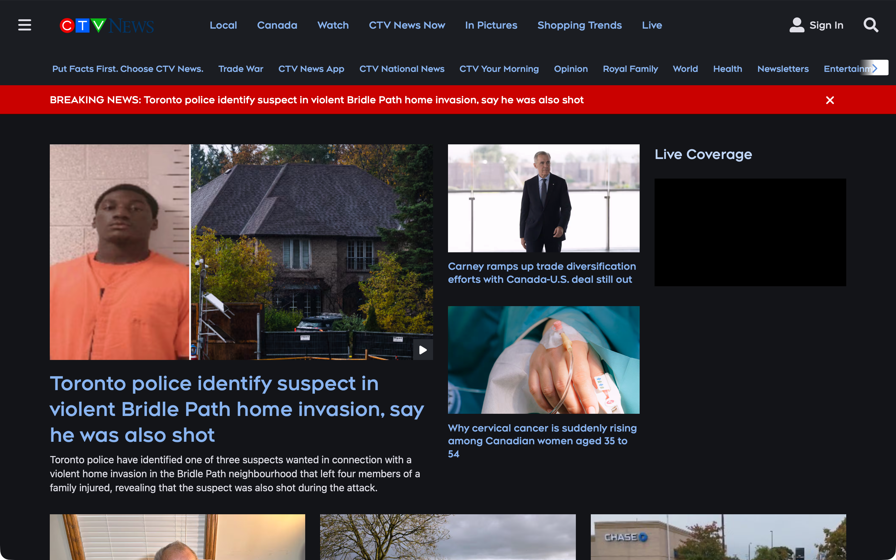

# CTV News & CP24 Dark Mode

A [Tampermonkey](https://www.tampermonkey.net/) userscript that gives
[ctvnews.ca](https://www.ctvnews.ca) and [cp24.com](https://www.cp24.com) — the
same Bell Media platform — a full dark theme.

## Install

1. Install the Tampermonkey extension for your browser (Safari, Chrome, Firefox, Edge).
2. Open the Tampermonkey dashboard → **Utilities** → **Import from file** and select
   `ctvnews-dark-mode.user.js` — or drag the file onto a browser tab.

The script matches `https://www.ctvnews.ca/*`, `https://ctvnews.ca/*`,
`https://www.cp24.com/*` and `https://cp24.com/*`, runs at `document-start`
(no white flash), and requires no special permissions (`@grant none`).

## Screenshot

Homepage top, desktop resolution:



## What it covers

- **Homepage** — header, breaking bar, article grid, sidebar, video sections, recipes,
  shopping trends, weather widget, app promos, newsletter, footer
- **Article pages** — headline, byline, body, photos/captions, related stories
- **Video pages** — player area, Top Videos, Latest Videos, channel pages
- **Search overlay** (Queryly) and the **Sections flyout menu**
- **Weather widgets** — including the Bell Media Weather (`bmw-*`) custom elements
- **CP24 specifics** — the CP24 red (`#be0a0a`, brightened to `#d42b2b`) stays as the
  accent on cp24.com (headlines, overlines), while ctvnews.ca keeps its blue accent;
  the `/weather` page's `bmw-weather-details` tabs and the Queryly search container are
  darkened on both sites. The traffic page's 511on.ca map iframe is cross-origin and
  left as-is (maps stay light, same as on CTV).

## How it works

The site is built on a design-token system (`--global-neutral-*`, `--global-blue-*`, …)
plus a partially wired-in native dark branch via CSS `light-dark()`. Three mechanisms do
the heavy lifting:

1. **Token inversion** — the neutral/blue scales are remapped at `:root` with
   `!important` on every custom property. `!important` matters: at `document-start`
   our stylesheet is first in `<head>`, and the site's own `:root` block would
   otherwise win the cascade.
2. **`light-dark()` re-pinning** — flipping `color-scheme: dark` activates the site's
   dark branch, but some of those variables resolve through the (now inverted) tokens
   to *light* values and paint light boxes. Those variables are re-pinned to dark
   values, and all list sections are forced to the page background. (See
   [the half-built dark mode](#the-sites-half-built-dark-mode-light-dark) below.)
3. **Shadow-DOM injection** — the Bell Media Weather widgets (`<bmw-summarised-weather>`
   and friends) render inside shadow roots with their own light palette
   (`--font-color: #000`), which page CSS cannot reach. The script injects a stylesheet
   into each widget's shadow root and watches for late-mounted widgets (sections on
   this site are lazy-rendered while scrolling) via a `MutationObserver` plus retry
   sweeps after custom-element upgrade.

### The site's half-built dark mode (`light-dark()`)

`light-dark(<light>, <dark>)` is a CSS Color Function that returns one of its two
arguments depending on the element's **used `color-scheme`** — not directly the OS
setting. The browser derives `color-scheme` on `:root` from `prefers-color-scheme`,
but CSS can override it per element.

ctvnews.ca turns out to have a **partially wired-in native dark design system**.
Its `:root` stylesheet defines variables whose values switch on `color-scheme`:

```css
--ct-content__border:          light-dark(var(--ct-border--on-light), var(--ct-border--on-dark));
--ct-background-shadow-color:  light-dark(var(--global-blue-1), var(--global-neutral-8));
--bt-footer-links-bar__background-color:
                               light-dark(var(--global-white), var(--global-neutral-8));
--b-header-nav-chain-custom-drawer-background-color:
                               light-dark(var(--global-blue-1), var(--global-neutral-8));
--bt-media-icon__background-color:
                               light-dark(var(--global-white), var(--global-neutral-10));
```

Our `color-scheme: dark` on `html` flips every one of these to its **dark branch** —
the site's dark-branch values really do resolve (that's exactly why this script
needed fixes). But the site never ships a complete dark theme: the body background
and main text colors are not wired through `light-dark()` at all, so on its own the
dark branch would produce dark borders and shadows on a still-white page with dark
text. This script supplies the missing theme, and the dark branches ride along.

The catch: the site's dark branches were written against the **original** token
palette, where e.g. `--global-neutral-8` is `#4F4F4F` — a dark surface color. This
script *inverts* that palette (neutral-8 becomes light gray `#9AA3AC`, because it is
also used for secondary text). So the dark-branch variables that expected a dark
surface resolved to **light** values, which painted the bugs seen during
development:

| Variable | Dark branch resolves to | Symptom |
| --- | --- | --- |
| `--ct-background-shadow-color` | inverted `neutral-8` (light gray) | Video player's `-24px` offset box-shadow painted light gray boxes behind card titles on `/video` |
| `--bt-footer-links-bar__background-color` | inverted `neutral-8` (light gray) | Light gray footer links bar |
| `--b-header-nav-chain-custom-drawer-background-color` | inverted `neutral-8` (light gray) | Light drawer (flyout) background |
| `--bt-media-icon__background-color` | inverted `neutral-10` (light blue) | Light blue play-button circles |

Box-shadows made the first one especially tricky to diagnose: they are painted but
not hit-testable, so `elementFromPoint()` at the affected text reported only
transparent elements.

The fix is a handful of explicit `!important` overrides in the same `:root` block
that re-pin those four variables to dark values, plus a blanket rule forcing every
`b-standard-list-custom` section (Top Videos, Recipes, Shopping Trends, …) to the
page background, since those sections use the inverted `--global-blue-8` as their
background.

## Files

- `ctvnews-dark-mode.user.js` — the userscript
- `screenshot.png` — homepage in dark mode

## Notes

- Sections lazy-render while scrolling; because the theme is plain CSS in `<head>`,
  newly mounted sections are styled as soon as they paint. The BMW watcher handles
  the shadow-DOM widgets the same way.
- The CTV red (`#EB0401`) is kept as the accent color — it reads well on dark.
  On cp24.com the site's own primary red (`#be0a0a`) fills that role instead,
  brightened to `#d42b2b` for contrast on dark surfaces.
